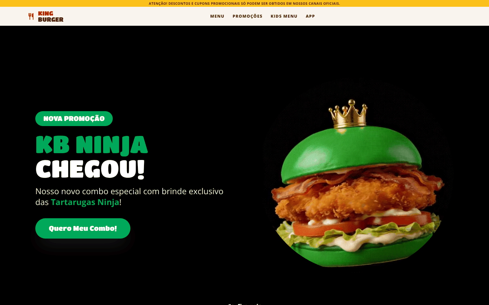
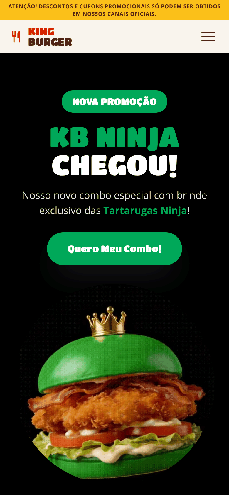

<h1 align="center">🍔 King Burguer</h1>

<p align="center">
  Landing page de uma hamburgueria fictícia, com promoção temática, cardápio filtrável, carrossel do Kids Menu e menu mobile acessível.
</p>

<p align="center">
  <a href="https://daniesolinho.github.io/king-burguer/"><strong>🔗 Ver o site ao vivo</strong></a>
</p>

<p align="center">
  
  
  
  
</p>

---

## 📸 Preview

<!-- Substitua pelos seus prints (veja a seção "Como adicionar os prints") -->
<p align="center">
  
  
</p>

---

## 📖 Sobre o projeto

O **King Burguer** é uma landing page desenvolvida durante o curso de Front-end da **DevQuest**. A proposta foi recriar a experiência de site de uma rede de fast food: destacar uma promoção nova, apresentar o cardápio e levar o usuário a baixar o app.

O projeto foi feito **sem frameworks**, só com HTML, CSS e JavaScript puro, com foco em:

- layout responsivo (desktop, tablet e celular);
- código semântico e acessível;
- interações simples, leves e sem dependências.

---

## ✨ Funcionalidades

| Funcionalidade | O que faz |
| --- | --- |
| **Menu mobile** | Abre e fecha com botão, fecha com `Esc`, devolve o foco ao botão e se ajusta automaticamente ao voltar para desktop |
| **Cardápio com filtros** | Filtra os produtos por categoria: Todos, Burgers, Bebidas e Acompanhamentos |
| **Carrossel do Kids Menu** | Navegação por setas, indicadores clicáveis e teclado (setas ← →) |
| **Hero animado** | Destaque da promoção com GIF e botão de rolagem para o conteúdo |
| **Seção do app** | Links para App Store e Google Play |
| **Movimento reduzido** | Respeita a preferência `prefers-reduced-motion` do sistema |

---

## 🧩 Seções da página

1. **Barra de aviso** sobre canais oficiais de cupons
2. **Hero:** promoção *KB Ninja*
3. **The Kings Bacon**
4. **King em Dobro:** combos a partir de R$ 25,90
5. **Ingredientes Premium**
6. **HMMMMM:** destaque dos Crispy Chicken Nuggets
7. **Kids Menu:** carrossel de brindes
8. **Nosso Menu:** cardápio com filtros
9. **Baixe o App:** Clube KB
10. **Rodapé** com navegação e redes sociais

---

## ♿ Acessibilidade

- HTML semântico (`header`, `nav`, `main`, `section`, `footer`)
- `aria-label`, `aria-expanded` e `aria-hidden` nos elementos interativos
- Textos alternativos (`alt`) descritivos nas imagens de conteúdo
- Navegação completa por teclado no menu e no carrossel
- Suporte a `prefers-reduced-motion`

---

## 🛠️ Tecnologias

- **HTML5** semântico
- **CSS3**: variáveis CSS, Flexbox, Grid e media queries
- **JavaScript (ES6+)**: manipulação do DOM, eventos, `matchMedia` e `dataset`
- **Google Fonts**: Titan One e Open Sans
- **Material Symbols** para ícones
- **GitHub Pages** para o deploy

---

## 📁 Estrutura de pastas

```
king-burguer/
├── index.html
├── css/
│   └── styles.css
├── js/
│   └── main.js
├── public/
│   └── images/      # imagens usadas no site
└── docs/            # prints usados neste README
```

---

## 🚀 Como rodar localmente

Não precisa instalar nada.

```bash
# 1. Clone o repositório
git clone https://github.com/DanieSolinho/king-burguer.git

# 2. Entre na pasta
cd king-burguer

# 3. Abra o index.html no navegador
#    ou use a extensão Live Server no VS Code
```

---

## 📚 O que eu aprendi

- Organizar uma landing page longa em seções reutilizáveis
- Criar um menu mobile acessível do zero, sem bibliotecas
- Filtrar elementos da página com `data-attributes`
- Montar um carrossel com navegação por teclado
- Adaptar o layout para várias telas com media queries

---

## ⚠️ Aviso

Projeto **educacional e sem fins comerciais**. "King Burguer" é uma marca fictícia. Personagens, produtos e imagens são usados apenas como exercício de estudo.

---

## 👩‍💻 Autora

Feito por **Daniella Solinho**

[](https://github.com/DanieSolinho)
[](https://daniellasolinho.com.br)
